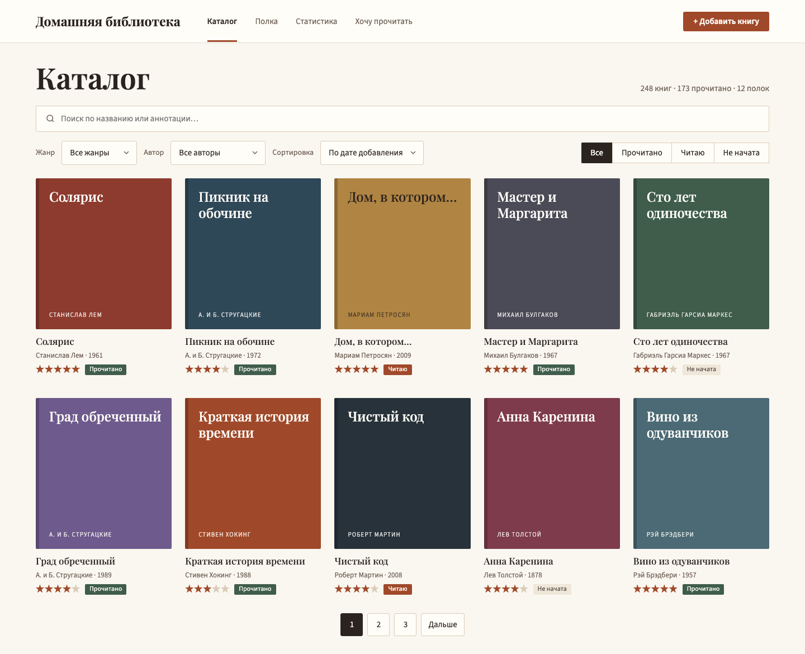
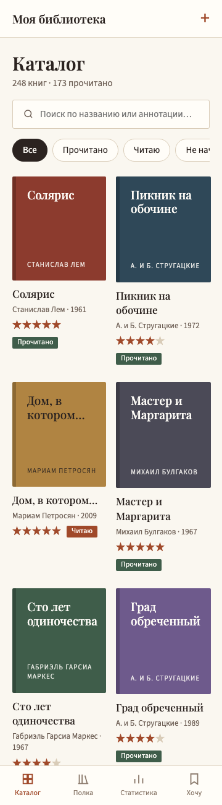

# Домашняя библиотека

Сайт для учёта домашней коллекции книг: каталог с поиском и фильтрами, карточка книги, добавление книги, расположение книг на полке, список для чтения и статистика чтения.

Вёрстка выполнена на HTML, CSS и JavaScript по макету из Figma и адаптирована под экраны 360, 768, 1024 и 1440 пикселей. Лабораторная работа №3 по дисциплине «Веб-программирование».

**Сайт:** https://babikovasofi.github.io/home-library/

  
  

